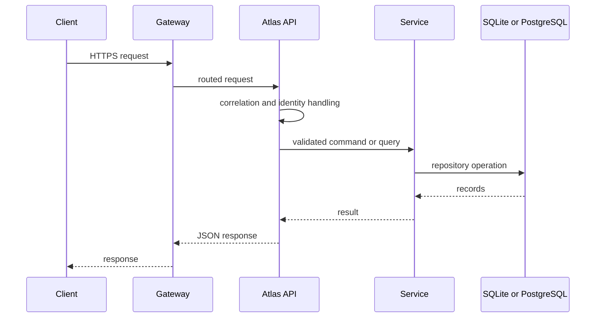

# Architecture

Atlas Order Services is a single FastAPI process with clear routing, service, repository, and persistence layers. Configuration is loaded once at startup and supports a local SQLite database or a PostgreSQL connection string supplied through the environment.

## Components

- The HTTP layer validates requests, establishes bearer identity, provides pagination, and returns JSON responses.
- Service classes coordinate order calculation, document recording, audit creation, and partner event preparation.
- Repository classes centralize SQLAlchemy access to customers, products, orders, documents, and audit events.
- The document component uses a configured local storage root in development.
- The partner component prepares delivery records without making outbound calls.
- Alembic owns schema evolution; the seed command creates deterministic local sample records.

## Request flow

## Persistence

The relational model records customers, products, orders and their line items, document metadata, and audit events. Product prices are stored as integer cents. Order totals are calculated from the selected product records rather than accepted from the caller.

SQLite is the default for local use. Set `ATLAS_DATABASE_URL` to a PostgreSQL SQLAlchemy URL to use PostgreSQL. The application has no database-specific business logic.

## Gateway boundary

The API exposes process and readiness probes for deployment orchestration. Application authentication applies to the versioned business API. Production deployments should establish routing, transport handling, and network boundaries at the gateway before traffic reaches the process.

## Operational visibility

Every request receives or retains a correlation identifier, which is returned in the response and included in JSON log events. Business operations that change order or operational state create audit records for later review.
